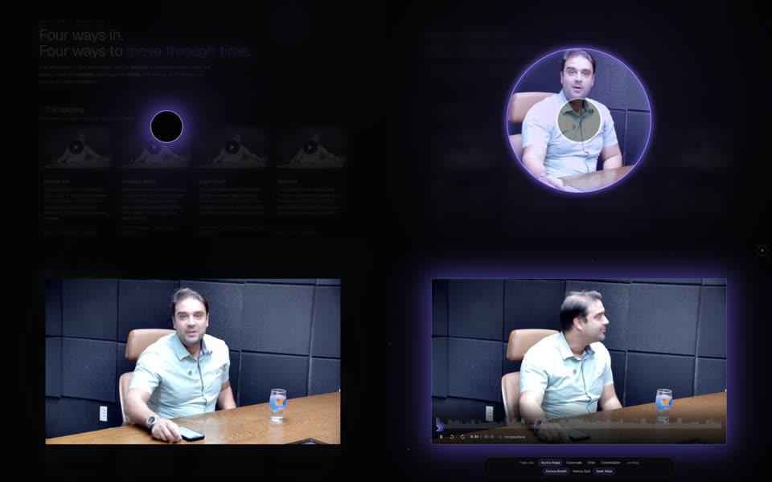
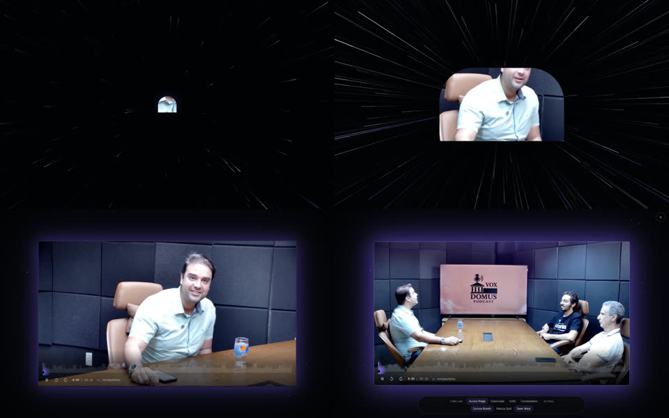
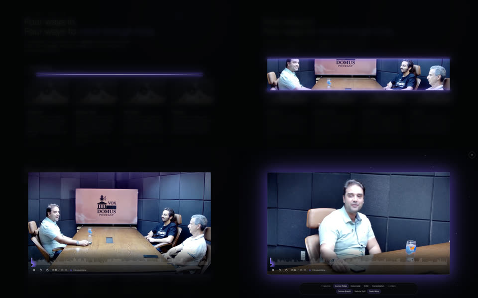
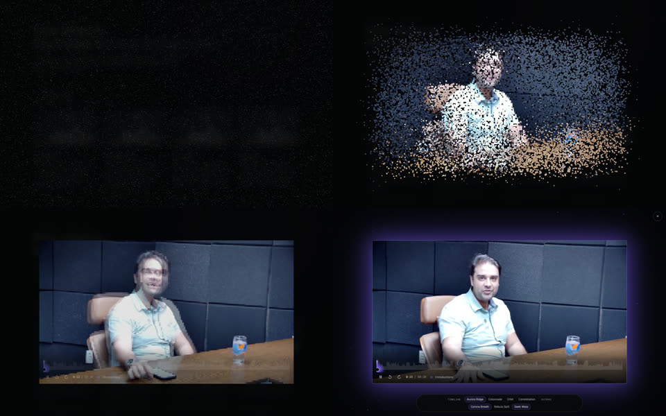
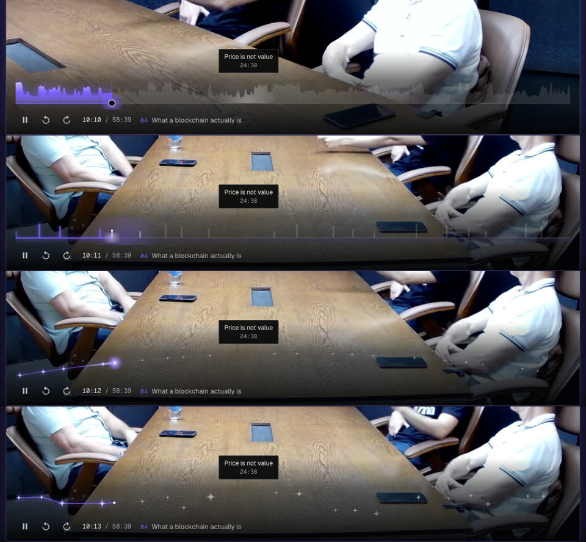

# Motion Library

A catalogue of motion and interaction ideas built for this world, with working prototypes. Reach for it before
inventing new motion: most needs (opening something, showing progress, marking a moment) are already covered here
in the site's own vocabulary: the **Eclipse and its corona**, stars, the **ring arc**, the **fog sea**, **colonnade
monoliths** that wake as the **light wave** passes, **gateways**, the **causeway** and the **traveller**.

Every entry was prototyped on real footage in `lab/player-concepts.html` and screenshotted in `refs/motion/`.
To run the lab, copy it to `public/media/lab.html` next to an encoded video, then open `/media/lab.html` on the dev
server. It expects `/media/vox-domus/episode-720p.mp4`, `poster.jpg` and `energy.json`.

**Status** says where an idea is live. The others are ready to lift into another context: project reveals, the
skills page, section transitions, loading states.

## Rules that apply to all of them

- One accent: violet `#7b61ff` (rgb 123, 97, 255) over near-black, with off-white `#edebe6` ink. Never a second hue.
- Motion carries meaning. Each idea maps to a world motif. Don't use one where its motif makes no sense.
- Keep it short: openings take about 0.9–1.7 s. Content must never wait on decoration.
- `prefers-reduced-motion`: openings become a crossfade, and loops freeze on a still frame.
- Canvas for anything per-frame (particles, ridges, streaks), WAAPI or CSS for element transforms and clip-paths.
  Per-frame values (glow, playhead) are written straight to the DOM or canvas, never through React state.
- An animation with `fill: "forwards"` outlives a style reset. When a reveal finishes, call `.cancel()` on its
  animations, or the end-state clip-path stays applied (it once cut the frame's glow into a circle).

---

## Openings: between a click and the content appearing

### A · Eclipse Iris

- **What:** the trigger is a small Eclipse (black disc, violet corona). On click, a fixed-position clone drifts to
  the target's center and scales ~2.4×, the corona flares, then the disc turns into a ring and the target is
  revealed by `clip-path: circle(r at 50% 50%)` growing from 0 to half its diagonal, with the ring riding the edge
  and fading out.
- **Timing:** travel 650 ms `cubic-bezier(.6,0,.2,1)` → flare 260 ms ease-in → iris 1050 ms ease-out (power 3.2).
- **Motif:** the Eclipse is the site's signature, so this reads as "the world opens".
- **Gotchas:** drop the disc's black fill the instant the iris starts (or it lingers as a grey ghost in the middle).
  The clone must sit in the same top layer as a `<dialog>`, so render it inside the dialog, not in the body.
- **Use for:** anything opened from an Eclipse-like trigger: media, the CV, a featured project.

### B · Gateway Warp

- **What:** full-screen canvas starfield. Stars stream outward as streaks, accelerating (`ease-in` over 70% of the
  time) then decelerating. The target is clipped to an arch, `inset(... round R R 3px 3px)`, that starts tiny in
  the center and grows with an exponential ease, like flying into a gateway. A glowing arch outline is drawn on the
  canvas. A 1.04 → 1 scale settle at the end gives a sense of arrival.
- **Timing:** 1.7 s total.
- **Motif:** the gateways and the transit corridor.
- **Use for:** the strongest "travel" moments, such as entering a project from its gateway or the final Contact
  gateway. Too loud for something small.

### C · Light Seam (live: talk player, opening and closing)

- **What:** a 2 px hairline of violet light draws out from the center (`scaleX` 0 → 1), flashes brighter, then
  splits into two lines riding the top and bottom edges while `clip-path: inset(50% 0 50% 0)` opens to
  `inset(0)`.
- **Timing:** draw 650 ms → flash 300 ms → split 900 ms ease-in-out.
- **Motif:** the hairline seams above the arches.
- **Use for:** quiet, elegant reveals such as panels, drawers or section intros. The most restrained of the four,
  and the safest default for UI.
- **Close:** the reverse. The edges converge back to the middle while the clip closes (420 ms), then the seam that's
  left collapses with `scaleX` 1 → 0 (320 ms), and the `::backdrop` fades out over both.
- **In the talk player:** `components/html/TalkPlayer.tsx`. The three seam lines are `position: fixed` inside the
  `<dialog>`, so the dialog must never get a transform.

### D · Stardust

- **What:** sample the target frame at 176×99 into an offscreen canvas. Each sample becomes a star particle
  scattered across the screen. They twinkle, then fly to their grid cell (staggered by distance from the center),
  shifting from star white or violet to the pixel's color and growing to the cell size. When they settle, the real
  content crossfades in over them. Rendering writes squares straight into a `Uint32Array` over `ImageData`, which
  handles ~17k particles at 60 fps in canvas 2D.
- **Timing:** 2.6 s, the longest.
- **Motif:** the starfield.
- **Use for:** a one-off, high-impact moment like the hero or a launch. Too heavy for something visitors will open
  more than once.

---

## Timelines: showing progress through something long

### 1 · Aurora Ridge (live: talk player)

(row 1)
- **What:** the bar is the media's real loudness per second (`energy.json`, normalized RMS from ffmpeg `astats`),
  drawn as a ridge rising from a baseline. Unplayed is dim ink, played is a violet gradient with a glow that grows
  with the current loudness. Chapters are 2 px breaks cut out with `destination-out`. The playhead is a tiny Eclipse
  (black disc, light rim, violet halo) that pulses with the voice. Hovering lifts a soft white light under the
  pointer.
- **Why it's the default:** it's the only timeline that carries information. You can see where the conversation
  gets lively.
- **Data:** `ffmpeg -i in.mp4 -vn -ac 1 -af "aresample=8000,asetnsamples=n=8000,astats=metadata=1:reset=1,ametadata=print:key=lavfi.astats.Overall.RMS_level:file=rms.txt" -f null -`,
  then normalize between the 3rd and 99.5th percentile.

### 2 · Colonnade
(row 2)
- **What:** a causeway line on the horizon over a fog gradient, with a monolith at every chapter start (heights vary
  in a fixed pattern). A small traveller (2 px body, round head, light pool underneath, bobbing while playing) walks
  the line. When the playhead crosses a chapter, its monolith **wakes**: a flash that decays over about 700 ms and
  settles to lit violet. A light-wave swell rolls ahead of the traveller once every ~7.5 s, matching
  `LIGHT_WAVE` in the scene.
- **Motif:** the most literal echo of the 3D world.
- **Use for:** guided sequences such as onboarding steps, a reading-progress bar for long articles, or the journey
  overview.

### 3 · Orbit
(row 3)
- **What:** time follows a shallow quadratic arc whose x is linear in time, so hit-testing stays a plain x→t
  mapping. A dashed dim arc shows what's ahead and a glowing arc what's been played. A comet head (radial gradient,
  size follows loudness) leaves a 36-dot fading tail. Chapters are four-point sparkles that brighten after the
  comet passes.
- **Motif:** the ring arc in the sky.
- **Use for:** cyclical or ambient progress such as loaders or slideshows.

### 4 · Constellation
(row 4)
- **What:** each chapter is a sparkle at a fixed pseudo-random height, sized by its length. Dotted lines link them,
  and played spans are redrawn as violet lines growing toward the playhead, which is a bright moving point. The
  current star has a pulsing halo, and a few faint background stars twinkle.
- **Motif:** the stars, plus the map-like idea of "where am I in this".
- **Use for:** navigating sections of something long, such as a chaptered article, the skills map or a timeline of
  roles.

---

## Extras: small touches that work with anything

### Corona Breath (live: talk player)
The frame's violet `box-shadow` follows the current loudness, smoothed (`s += (target - s) * 0.12` per frame). Use
an outer spread of 30–100 px and alpha 0.18–0.58. When paused it settles to a low idle glow. The frame feels alive
without moving anything.

### Nebula Spill
Draw the video into a 16×9 canvas about every 120 ms, upscale it with smoothing into a canvas 1.5× the frame, and
apply `filter: blur(80px) saturate(1.4)` at 0.55 opacity behind the frame. This is ambilight in the world's
language. It needs a same-origin (or CORS-enabled) video, or the canvas becomes tainted.

### Seek Warp
On a jump of more than 20 s, set an impulse with the jump's sign (decaying ×0.93 per frame) that pushes the
background starfield sideways as streaks. The space reacts to time travel.

---

## Baseline: the quiet player (for comparison)
A segmented progress bar (one segment per chapter), thumbnail preview on hover, and a side panel with chapters.
It's clean but generic. It stays the reduced-motion and no-canvas fallback.

---

## Emblems: living thumbnails in the world's palette (live: Community rows)

When an item's only image comes from someone else's design system (Luma share cards, platform covers, light or
colorful screenshots), don't show it. Draw an emblem instead. Each emblem is a 112×63 dark frame with a few star
dots and a violet haze, **one landmark taken from the item's own imagery, drawn in light**, and **one quiet motion that
says something about the item**. Pure CSS and SVG, no client JS. Under reduced motion they freeze.

| Emblem | Landmark (from) | Motion (meaning) | Code |
|---|---|---|---|
| Domus | Colonnade temple (Vox Domus logo) | Eclipse breathing, voice ripples (a podcast) | `TalkPlayer.tsx` (`.talk-object`) |
| Rio | Corcovado + Christ, city, palm, Sugarloaf + cable car (the Devin Meetup cover's line art) | Eclipse moon with two tasks orbiting at different speeds (goroutines vs Tokio); shimmer on the water | `EventEmblem.tsx` `rio` |
| Obelisk | The Obelisco on its plinth (Invisible Garden cover) | The light wave climbs it every 4.2 s; violet voxel petals rise (the voxel garden, the jacaranda) | `EventEmblem.tsx` `obelisk` |

Recipe for a new one: pick the single most recognizable object in the item's own cover, draw it in 0.9 px strokes
(`.em-line`) or a lit gradient fill (top `rgb(196,184,255)` at 0.7 down to ink at 0.1), set it on the `.em-base`
horizon, and give it one motion borrowed from the world (breathing, the light wave, orbit, rise). If it needs two
motions to make sense, the landmark is the wrong one.
